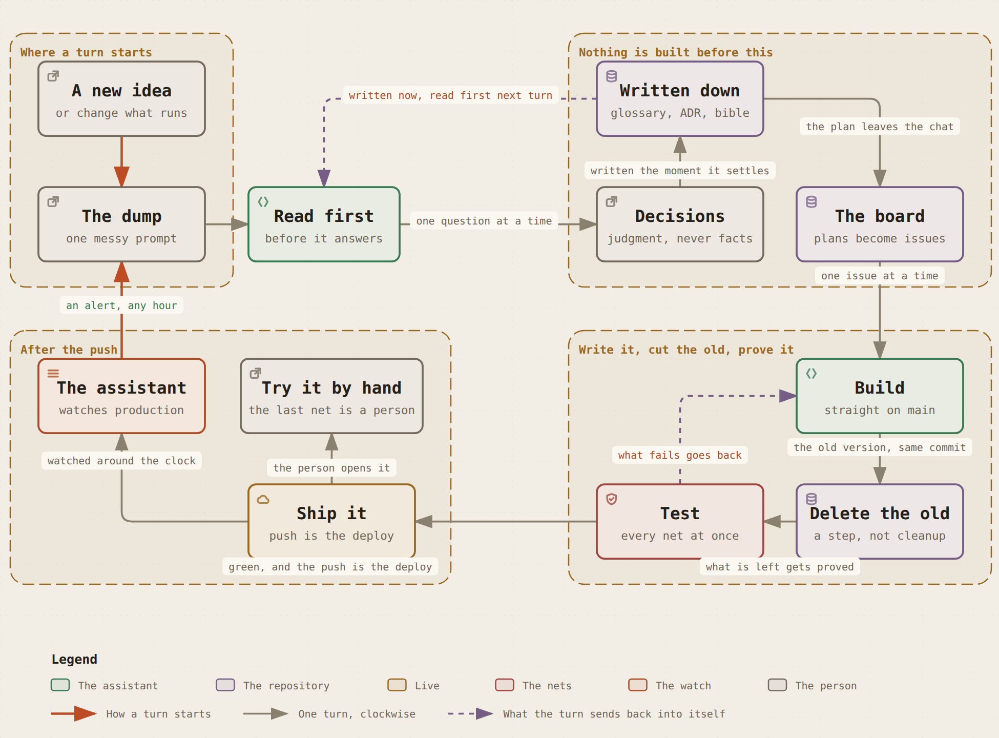
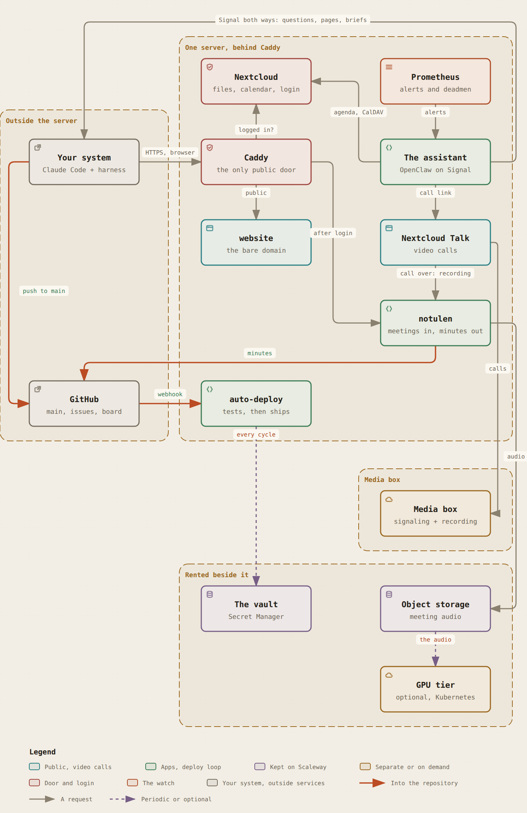

# babon-harness

The setup Babon Innovations runs its company on: a Claude Code harness, and an optional self-hosted stack on one server. MIT.

You make the decisions. The agent plans with you before it builds, hooks stop its known mistakes, and an index answers its questions.

<a href="https://babon-innovations-b-v.github.io/babon-harness/diagrams/stack/loop.html">
  <picture>
    <source media="(prefers-color-scheme: dark)" srcset="docs/diagrams/images/loop-dark.png">
    
  </picture>
</a>

**[Open the full interactive loop](https://babon-innovations-b-v.github.io/babon-harness/diagrams/stack/loop.html)**: step through it with the arrow keys; click a box for what it does and the bible section that explains it.

## Contents

| Path | What it is |
|---|---|
| `.claude/skills/` | 29 skills, run as `/<name>`. A task goes `/grill` (agree the plan), `/to-prd` (write it as an issue), build, `/close` (ship it). |
| `.claude/hooks/` | 15 hooks. They block torn commits, force pushes, tests that cannot fail, and new markdown files you did not approve. |
| `.claude/index/` | A code index ([codebase-memory-mcp](https://github.com/DeusData/codebase-memory-mcp)). Built on first use; nothing keeps running. |
| `docs/` | How it all works: one bible chapter and one interactive diagram per part. |
| `apps/`, `infra/` | The optional stack: website, Nextcloud sign-in, meeting minutes, a Signal assistant that keeps the agenda, recorded video calls, monitoring, and deploys that run the tests first. |

<a href="https://babon-innovations-b-v.github.io/babon-harness/diagrams/stack.html">
  <picture>
    <source media="(prefers-color-scheme: dark)" srcset="docs/diagrams/images/stack-dark.png">
    
  </picture>
</a>

**[Open the full interactive stack](https://babon-innovations-b-v.github.io/babon-harness/diagrams/stack.html)**: every part, with its explanation.

## Requirements

- Linux or macOS (Windows through WSL2), `git`, `python3` 3.12+, [`uv`](https://docs.astral.sh/uv/), the GitHub CLI
- Claude Code and a GitHub account
- For the stack: a Scaleway account, a domain, an Anthropic API key, a Signal number

Costs and details: [setup/reference](docs/bible.md#setupreference).

## Quick start

```bash
git clone https://github.com/Babon-Innovations-b-v/babon-harness.git my-company
cd my-company
bash .claude/scripts/bootstrap.sh                 # git hooks, index, gh check
python3 .claude/scripts/setup-github.py --board   # labels, board, .claude/project.json
claude
```

Then describe your first piece of work. For the whole stack, say `set up my harness`.

The workflow is built for `claude --dangerously-skip-permissions`, which gives the agent your shell. Read [Permissions](docs/bible.md#setupreference) first.

## Providers

Built on Claude Code and Scaleway. Skills are markdown, hooks and the index are Python, and the stack is Docker Compose, so moving to another agent or cloud is a port, not a rewrite.

## Docs

- How a task runs: [workflow/loop](docs/bible.md#workflowloop)
- What a module looks like: [workflow/module-standard](docs/bible.md#workflowmodule-standard)
- The stack, part by part: [docs/bible.md](docs/bible.md)
- Keeping several repositories on one harness, configuration, costs: [setup/reference](docs/bible.md#setupreference)

## Support

None promised. Issues are welcome. Questions: support@babon.eu. Security problems: see [SECURITY.md](SECURITY.md), never a public issue.

## Credits

| Work | Licence | Used for |
|---|---|---|
| [Matt Pocock's skills](https://github.com/mattpocock/skills) | MIT | `grill`, `triage`, `diagnose`, `tdd`, `prototype`, `improve-codebase-architecture`, `codebase-design`, `write-a-skill`, `zoom-out`, `retro`, parts of `handoff` and `wayfinder` |
| [caveman](https://github.com/JuliusBrussee/caveman) by Julius Brussee | MIT | the `caveman` skill |
| [ponytail](https://github.com/DietrichGebert/ponytail) | MIT | the lean-code rules in `CLAUDE.md` |
| [codebase-memory-mcp](https://github.com/DeusData/codebase-memory-mcp) | MIT | the code index |
| [archify](https://github.com/tt-a1i/archify) | MIT | the diagram renderer |
| [OpenClaw](https://github.com/openclaw/openclaw) | MIT | the assistant's gateway |
| Signal, transcription and stack components | see [`THIRD_PARTY_NOTICES.md`](THIRD_PARTY_NOTICES.md) | |

Claude Code is Anthropic's software and is not part of this repository. This project is not affiliated with Anthropic.

## Licence

MIT, Copyright (c) 2026 Babon Innovations B.V.
