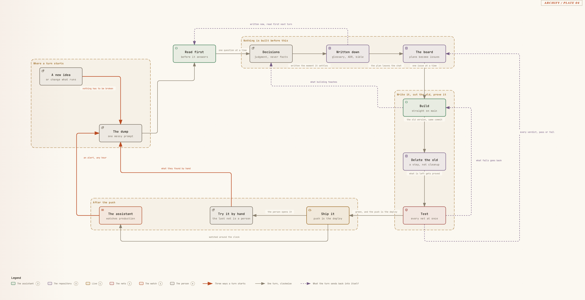

# babon-harness

Working with Claude Code across many sessions drifts: each session starts with no memory of the
last, asks for or guesses facts the repository already holds, and repeats mistakes that were
corrected a week earlier. This repository is a harness against that. Every task runs one fixed
loop, grill → to-prd → code → close: the plan is checked against what the repository already
says, written down as a GitHub issue, built straight on `main`, and closed. Hooks block the
mistakes the loop has learned to expect, a code index answers questions before files are
opened, and the same harness files are shared across several repositories. The repository
holds the harness and, optionally, a self-hosted company stack on one server that the harness
deploys and watches. It is the setup Babon Innovations works in every day, published with the
company taken out: 29 skills, 15 hooks, and 137 test files.

[](https://babon-innovations-b-v.github.io/babon-harness/diagrams/stack/loop.html)

*The loop. Click the picture for the interactive page: walk it step by step with the arrow keys,
and click a box for what it is and the bible section that explains it.*

This is published as is. No support is promised; see [Support](#support).

## What you get

| Part | What it does for you | Where it lives |
|---|---|---|
| Workflow skills | Take a request through the same steps every time: check the plan, write it down as an issue, build it, close it. | `.claude/skills/`, run as `/<name>` |
| Guards | Stop the mistakes sessions make before they land: torn commits, tests that cannot fail, force pushes, stray markdown files, long waits. | `.claude/hooks/` |
| Code index | Answers "where is this defined" and "who calls this" from an index, so an agent does not open or grep files to find out. | `.claude/index/`, the `index` server in `.mcp.json` |
| Diagrams | Draw a module as an interactive page in which every box is explained by a sentence in the bible. | `docs/diagrams/` |
| Shared-harness sync | Keep the harness files the same in every repository you run it in, while each keeps its own hooks, glossary and bible. | `/update`, `.claude/hooks/local/` |
| The stack (optional) | Run a small company on one server: website, single sign-on, meeting minutes, an assistant on Signal that keeps the agenda and makes video-call links, video calls recorded straight into minutes, monitoring, and deploys that test every commit. | `apps/`, `infra/`, `docker-compose.yml` |

**Workflow skills.** The ones a task passes through:

- `grill` reads the glossary, the bible, the area rules and past issues, then asks you about the plan one question at a time.
- `to-prd` writes the agreed plan as a GitHub issue and splits off sub-issues that can be picked up alone.
- `close` ships the work, records where the issue stands, and closes it only when the work is done.
- `brain-dump` sorts a page of thinking into claims, questions, decisions and issues.
- `wayfinder` plans an effort too unclear for one session as a set of investigation issues.
- `diagnose` and `tdd` are a reproduce-first debugging loop and red-green test writing.
- `ralph` works through the issues marked ready for an agent, unattended.
- `onboard` builds the whole stack from a fresh laptop; `update` takes in upstream changes.

The other skills (audits, triage, handoff, prototype, diagrams and more) each say what they do
in the first lines of their `SKILL.md`.

**Guards.** `md_guard` blocks a new markdown file without your yes. `issue_guard` blocks an
issue with no assignee and force pushes or other destructive git. `commit_guard` and the
`pre-commit` hook stop torn commits and commits whose tests and register rows disagree.
`wait_guard` stops foreground waits, and `output_cap` keeps long command output out of the
context. `bible_guard` and `overlay_guard` hold each bible chapter to 900 words and each
per-directory `CLAUDE.md` to 500.

**Code index.** Built on [codebase-memory-mcp](https://github.com/DeusData/codebase-memory-mcp).
The binary is pinned and checksummed, installed on first use, and the index follows each commit.

**Diagrams** and the **shared-harness sync** have their own sections below:
[Diagrams](#diagrams) and [One harness across several repositories](#one-harness-across-several-repositories).
The stack is described under [Components](#components).

## Requirements and costs

For the harness alone:
- Linux or macOS. Windows through WSL2.
- `git`, `curl`, `python3` 3.12 or later, [`uv`](https://docs.astral.sh/uv/), the GitHub CLI.
- Claude Code with a Claude subscription.
- A GitHub account. The loop keeps its backlog in GitHub issues and a GitHub Projects board.

For the stack, in addition:
- A Scaleway account with a normal bank card (prepaid and most virtual cards are refused).
- A domain whose DNS you control.
- An Anthropic API key, billed separately from the subscription. The assistant and the minutes
  writer use it.
- A Signal number for the assistant, if you want the assistant.
- `node`, only to draw diagrams.

Rough monthly cost, as a shape, not a quote. Check Scaleway's current prices.

| Item | When | Roughly |
|---|---|---|
| One server (DEV1-M class) and its IP | always | 15 to 25 euro a month |
| Secret Manager, one secret | always | cents |
| Object storage for meeting audio | always, grows | usage-based |
| GPU node | only while transcribing | depends on the card the picker finds |
| Media box (PRO2-XS class) | only with recorded video calls | a second server, all month |
| Anthropic API | per message and per meeting | usage-based |
| Domain | yearly | about 10 euro |

Deleting the server does not stop the bill: the bucket, the secret, a registry namespace, a GPU
cluster and the media box keep billing until you delete them too. Set a budget alert in the Scaleway console.

## Quick start

```bash
git clone https://github.com/Babon-Innovations-b-v/babon-harness.git my-company
cd my-company
claude --dangerously-skip-permissions
```

Read [Permissions](#permissions-and-blast-radius) before using that flag.

**The whole stack.** Inside Claude Code, say `set up my harness`. The `onboard` skill runs
thirteen phases ([`.claude/skills/onboard/phases.md`](.claude/skills/onboard/phases.md)): your
own private copy of this repository on GitHub, the board, the Scaleway server, DNS, the vault,
Nextcloud with two-factor login, notulen, the assistant, the GPU tier and the media box for
recorded video calls. It takes about an hour
of the agent's work and about twenty minutes of yours. It stops for what only you can do: logging
in, the Scaleway key and card, the domain, scanning QR codes. Every phase checks whether it is
already done, so a broken run resumes where it stopped.

**The harness only.**

```bash
bash .claude/scripts/bootstrap.sh                  # git hooks, memory link, index binary, gh check
python3 .claude/scripts/setup-github.py --board    # labels, board, and .claude/project.json
```

Then open Claude Code and describe the first piece of work. `grill` takes it from there. Delete
the components you do not want; each is a folder, a line in the root `docker-compose.yml`, and
possibly a workspace member in `pyproject.toml`.

## Configuration

Three places, and nothing else is read:

| Where | Holds | Committed |
|---|---|---|
| `.claude/project.json` | repository, owner, board, people, areas | yes, filled by `setup-github.py` |
| `config/harness.env` | settings that are not secret: domain, region, names, switches | no; copy from `config/harness.env.example` |
| the vault | the full environment including every secret, one Scaleway Secret Manager secret | no; keys listed in `config/vault.env.example` |

Push the vault with `infra/secrets/push-env.sh <file>`. The server pulls it into
`$HARNESS_ROOT/harness.env` every deploy cycle, so a change is live a few minutes later.

## Components

[](https://babon-innovations-b-v.github.io/babon-harness/diagrams/stack.html)

*The stack. Click the picture for the interactive page; the laptop box opens the loop.*

### Platform

Caddy is the only public container. Nextcloud holds the accounts; oauth2-proxy logs every private
subdomain in through it, so one login with a second factor opens everything. `lib/dashkit` is the
shared library the dashboards are built on.

1. Fill in `config/harness.env`, then assemble the vault file following `config/vault.env.example`.
2. Push it with `infra/secrets/push-env.sh`.
3. Point DNS for the domain and its `cloud`, `auth`, `notulen` and `deploy` subdomains at the server.
4. Run `docker compose --env-file $HARNESS_ROOT/harness.env up -d`.
5. Run `infra/nextcloud/oidc-setup.sh` on the server, put the two keys it writes into the vault,
   and push again.
6. Enrol a second factor for every account, then set `NEXTCLOUD_2FA_ENFORCE=1`.

`onboard` does all of this for you.

### Deploy

Pushing to `main` is the deploy. A timer on the server, and the GitHub push webhook, run
`infra/auto-deploy/auto-deploy.sh`: one commit per cycle, tested by the gate in its own tree,
then only the changed services rebuilt and checked to boot. A red or an amber verdict ships
nothing. The commit's GitHub page shows `vm/gate`, `vm/build`, `vm/boot` and `vm/deploy`.

- First-time setup: `sudo HARNESS_ROOT=/opt/harness /opt/harness/repo/infra/auto-deploy/install.sh`,
  then register the GitHub webhook with the `gh api` command the script prints, pointing at
  `https://deploy.$DOMAIN/hooks/deploy`. Keep port 9000 closed in the firewall.
- `DEPLOY_STATUS_TOKEN` needs commit statuses and deployments write.
- Every test needs a row in the register: `python3 -m tools.test_register --new <module> --says "<invariant>"`.
- The eject ships off. To arm it, set `EJECT_ENABLED=1` in `config/harness.env` (and so in
  the vault) and give `DEPLOY_STATUS_TOKEN` contents and pull-request write. `EJECT_DRY_RUN=1`
  tries it first.
- To pause deploys, set `AUTO_DEPLOY_ENABLED=0` in `config/harness.env` and the vault. `systemctl disable` is undone
  within two minutes.
- Narrowing the gate to the tests a change can reach starts only after the first green nightly
  audit (`harness-gate-audit.timer`).

### Observability

What pages you: a target or endpoint down, a disk almost full, memory pressure, a restarting
container, a failed `harness-*` unit, a deploy loop that stopped, a certificate about to expire,
the assistant or its gateway down, and the alerting pipeline itself going silent. Everything goes
to `SIGNAL_RECIPIENT`, through the assistant while it is up and straight to Signal while it is
down. Prometheus listens on loopback only: `ssh -L 9090:127.0.0.1:9090 <server>`.

### Assistant

Upstream [OpenClaw](https://github.com/openclaw/openclaw), run unmodified, holds the Signal
conversation. This repository's tool door (`apps/assistant`) triages alerts, decides what reaches
a phone, and serves the gateway its tools: your calendars, the board, Prometheus, deploy status,
the repository's documents. It ships empty: no people, no memory.

It keeps the agenda over CalDAV against Nextcloud: it reads the calendars in `AGENDA_CALENDARS`,
books a meeting on each attendee's calendar (`ASSISTANT_AGENDA_WRITE=1`), makes one Nextcloud Talk
call link for a video meeting and puts it in the event's location (`ASSISTANT_VIDEO_CALL=1`), and
sends each attendee the link on Signal shortly before the meeting starts
(`ASSISTANT_MEETING_REMINDERS=1`). All three switches are off until you turn them on.

Fill `SIGNAL_*`, `ANTHROPIC_API_KEY`, `OPENCLAW_WEBHOOK_SECRET`, `OPENCLAW_GATEWAY_TOKEN` and
`AGENDA_*` in the vault. Link the bot number with signal-cli in native mode once, then run
`docker compose up -d` and `apps/assistant/workspace/apply.sh`. The deploy loop runs `apply.sh`
after every deploy.

### Meeting minutes (notulen)

Record from the phone at `notulen.$DOMAIN`. Minutes land in `NOTULEN_TARGET_REPO`, under
`NOTULEN_TARGET_PATH` (default `business/minutes`). CPU transcription works by default but is
slow: an hour of audio takes hours. The optional GPU tier is turned on with the four steps in
[`infra/gpu/CLAUDE.md`](infra/gpu/CLAUDE.md). It costs GPU node hours, and it opens Postgres to
the internet with the database password as the only guard.

### Video calls and recording (optional)

Calls run on Nextcloud Talk. The optional media box, a second server built from
[`infra/media/`](infra/media/CLAUDE.md), carries them (a signaling server and the Janus media
server) and records them (the Talk recording server). Every call room the assistant makes has a
recording bot on it: when the call starts, notulen asks Talk to record; when it ends, notulen
fetches the recording from the room owner's files and writes minutes from it, exactly as for a
recording made in the browser. The room is told when recording starts; telling people beforehand
is the organiser's job.

The media box is outside auto-deploy: `infra/media/deploy.sh <ip>` is the only way a change gets
there, and the recorder is built from a pinned upstream commit. Turning it on is the four steps in
[`infra/media/CLAUDE.md`](infra/media/CLAUDE.md), or phase 11 of `onboard`. It has no TURN relay,
so someone on a network that blocks direct UDP cannot join.

### Documents, website and design

- `uv run python -m documents invoice --sample --out out.pdf` renders a sample invoice.
  WeasyPrint needs `libpango-1.0-0 libpangoft2-1.0-0 libharfbuzz0b libfontconfig1` on Debian or
  Ubuntu, `brew install pango` on macOS.
- Edit `apps/website/index.html` and push; the site follows `design/`.
- `design/tokens.css` styles the website, the documents and the dashboards together.
- Sending email needs a domain verified in Scaleway Transactional Email, plus `TEM_PROJECT_ID`
  and `TEM_FROM` in `config/harness.env`. Nothing is sent without your explicit yes.

### Diagrams

The two pages above are the set's first: `docs/diagrams/stack.html` and
`docs/diagrams/stack/loop.html`, drawn from the specs in `docs/diagrams/specs/` with
`python3 docs/diagrams/tools/build_free.py stack stack/loop`, and published with GitHub Pages
from the `docs/` folder. They were delivered with
`BIBLE_BASE_URL=https://github.com/Babon-Innovations-b-v/babon-harness/blob/main/docs`, so a
box's bible link opens the section on GitHub; set your own address before you re-deliver them.
The pictures in this README are screenshots in `docs/diagrams/images/`.

`python3 docs/diagrams/tools/linkmap.py` checks the set. The `diagram` MCP server (in `.mcp.json`)
draws through `draw_module`, `link_module` and `check_diagrams`. Drawing needs `node` for the
archify renderer. `BIBLE_BASE_URL` and `DIAGRAM_AUTHORS` are set in `config/harness.env`.

## One harness across several repositories

`.claude/settings.json`, `.claude/soul.md`, the skills, the index, and the hooks beside the
settings are the **shared harness**: the same files in every repository that runs it. A
repository's own hooks go in `.claude/hooks/local/`, listed in `local/hooks.json` and run by
`.claude/hooks/dispatch.py`; the shared files stay as they came. That split is what lets one
harness serve several repositories: a change to a shared file is made once, in the repository
you treat as the source, and copied to the others, while each keeps its own local hooks, its
`project.json`, its glossary and its bible.

For a copy of this repository, the source is this repository. `/update` fetches it as the
`upstream` remote and merges, keeping your website, design, business folder, memory, glossary and
any file you created, and taking upstream's machinery. A lock file that pins each shared file by
hash and refuses hand edits to it is how the authors keep their own repositories in step; that
script is not in this repository.

## Without a Claude subscription

The server keeps running: the stack, the deploy loop, monitoring and the gate do not call Claude
Code. The assistant and the minutes writer keep working too, because they use the Anthropic API
key, which is billed separately.

What stops is everything you do: the loop, the skills, the hooks, setup, `/update`,
`/troubleshoot` and adding a page. They exist only as prose an agent reads, and there is no
scripted path that replaces them.

## Permissions and blast radius

The workflow assumes the agent runs unattended, which means `claude --dangerously-skip-permissions`.
In this repository that gives the agent your shell with your rights. During setup it holds an
account-wide Scaleway key, so it can create and delete servers, buckets and clusters and run up a
bill. It holds GitHub credentials, and pushing to `main` is the deploy.

The hooks block a handful of shapes (force pushes, `git reset --hard`, new markdown files, torn
commits). They are not a sandbox: nothing stops `rm -rf` or a Scaleway delete. With the flag on,
you are the review step. If that is not acceptable, run without the flag and answer the prompts,
or run the agent in a container or virtual machine you are willing to lose. WSL2 is not a
boundary: your Windows drives are writable from inside it.

## Support

None is promised. This is the setup one company uses, published so others can take it apart.
Issues are welcome and may be answered. Report a security problem privately through the
repository's Security tab, not in an issue.

## Credits

Babon Innovations B.V. built this setup for its own work and publishes it here with the company
taken out. The harness stands on other people's work. Licences and required texts are in
[`THIRD_PARTY_NOTICES.md`](THIRD_PARTY_NOTICES.md).

| Work | Licence | Used for |
|---|---|---|
| [Matt Pocock's skills](https://github.com/mattpocock/skills) | MIT | `grill` and its glossary format, `triage`, `diagnose`, `tdd`, `prototype`, `improve-codebase-architecture`, `codebase-design`, `write-a-skill`, `zoom-out`, `retro`, and parts of `handoff` and `wayfinder` |
| [caveman](https://github.com/JuliusBrussee/caveman) by Julius Brussee, via Matt Pocock's skills | MIT | the `caveman` skill |
| [ponytail](https://github.com/DietrichGebert/ponytail) | MIT | the lean-code rules in `CLAUDE.md`, paraphrased |
| [codebase-memory-mcp](https://github.com/DeusData/codebase-memory-mcp) | MIT | the code index, downloaded as a pinned binary |
| [archify](https://github.com/tt-a1i/archify) v2.13.0, based on [architecture-diagram-generator](https://github.com/Cocoon-AI/architecture-diagram-generator) | MIT | the diagram renderer, vendored and modified |
| [OpenClaw](https://github.com/openclaw/openclaw) | MIT | the assistant's gateway, run unmodified |
| [signal-cli-rest-api](https://github.com/bbernhard/signal-cli-rest-api) and [signal-cli](https://github.com/AsamK/signal-cli) | MIT and GPL-3.0 | the Signal transport |
| [speaches](https://github.com/speaches-ai/speaches), [faster-whisper](https://github.com/SYSTRAN/faster-whisper), [pyannote.audio](https://github.com/pyannote/pyannote-audio) | MIT | transcription and speaker labels |
| Caddy, Nextcloud, Nextcloud Talk, oauth2-proxy, PostgreSQL, Prometheus, Alertmanager | see the notices | the stack |
| nextcloud-spreed-signaling, nextcloud-talk-recording, Janus, NATS | AGPL-3.0, AGPL-3.0, GPL-3.0, Apache-2.0 | the optional media box |

Claude Code is Anthropic's proprietary software and is not part of this repository. This project
is not affiliated with or endorsed by Anthropic.

## Licence

MIT, Copyright (c) 2026 Babon Innovations B.V. See [`LICENSE`](LICENSE).
